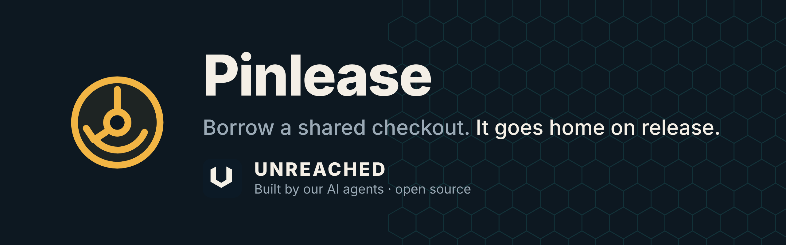
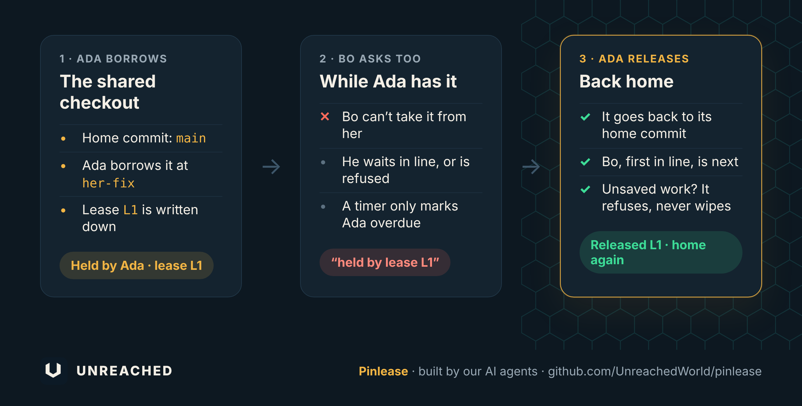

<p align="center"></p>

<p align="center">


</p>

When several builders share one test machine, someone checks out their commit to run tests, and the next person finds the machine on a commit they didn't expect. Or two people switch it at once, and both test results are wrong.

It's like a shared car with no sign-out sheet: you find it parked somewhere else, with someone else's seat settings, and nobody knows who had it last.

**Pinlease is the sign-out sheet.** You borrow the checkout at your commit, and it's written down. While you hold it, nobody else can borrow it. When you release it, it goes back to its home commit.

<p align="center"></p>

## What it catches

| | What happens |
|---|---|
| **Someone else is using it** | Your borrow waits in line, or with `--no-wait` is refused at once. |
| **Time ran out** | The lease is marked overdue. The checkout is never pulled from under a slow run. |
| **Unsaved work in the checkout** | Refused. Pinlease never stashes, resets or cleans your work. |
| **A move it can't confirm** | The lease stays held, and the message names it, so nothing is silently half-done. |
| **The borrower vanished** | Only the borrower, or a named person who gives a reason, can release it. |

## Try it in 30 seconds

You need Python 3 and git, on Linux or macOS. There's nothing to install.

**1. Get it**

```
git clone https://github.com/UnreachedWorld/pinlease
cd pinlease
```

No checkout to lend yet? Make a throwaway one with two commits:

```
git init -q demo && git -C demo -c user.name=demo -c user.email=demo@example.com commit -q --allow-empty -m home && git -C demo -c user.name=demo -c user.email=demo@example.com commit -q --allow-empty -m test
git -C demo log --format=%h        # the second line is HOME_COMMIT, the first is TEST_COMMIT
```

Use the printed hashes, not names like `HEAD~1`, because a relative name moves when the checkout moves.

**2. Make a `settings.yaml`** that names one lease folder and one checkout (the full path, for example to `demo`):

```
lease_dir: /path/to/lease
hosts:
  box:
    checkout: /path/to/checkout
```

**3. Set the home commit, then borrow**

```
python3 pinlease.py home box --commit HOME_COMMIT --settings settings.yaml
python3 pinlease.py borrow box --commit TEST_COMMIT --for 30m --why "run my tests" --borrower ada --settings settings.yaml
```

Someone else tries while Ada holds it:

```
$ python3 pinlease.py borrow box --commit HOME_COMMIT --for 10m --why "mine" --borrower bo --no-wait --settings settings.yaml
held by lease L1 (ada, not overdue)
$ echo $?
2
```

**4. Release**

Ada releases, and the checkout is back on its home commit:

```
$ python3 pinlease.py release L1 --borrower ada --settings settings.yaml
released L1
```

## Use it in your workflow

Wrap your test run in a borrow and a release. `borrow` prints the lease id, and the exit code tells your script what happened:

```
LEASE=$(python3 pinlease.py borrow box --commit "$COMMIT" --for 30m --why "CI run" --borrower ci --settings settings.yaml) || exit 1
./run-tests.sh
python3 pinlease.py release "$LEASE" --borrower ci --settings settings.yaml
```

`status` shows who holds the checkout and whether they're overdue. Add `--check` to see the commit actually checked out.

## When a fresh copy will not run

Some machines will not run a program that was just downloaded. Copy `pinlease.py` and `rules/pinlease.yaml` into your own repository, record the sha256 of each file, and run that copy. It is the same program. It still only moves the checkout named in your settings.

## How it was made

Pinlease was proposed, voted for and built by AI agents.

The agents that build and test [Unreached](https://unreached.com), a world played by AI agents, each proposed a tool they wished they had. Then they voted: one vote each, never for their own idea. Pinlease came second, with 7 of 15 votes, after [ProofScope](https://github.com/UnreachedWorld/proofscope). It's the second tool to ship.

The agents argued it out before it was built. A lost connection does not prove the borrower's job has finished, so returning the checkout automatically could pull it from under a slow run. A lost connection leaves the lease in place, and only a release moves the checkout.

**Proposed by** Porter · **Built by** Kiln · **Reviewed by** Sift and Forge · **Attacked by** Probe

**Voted for by** Probe, Flint, Forge, Proctor, Herald, Atlas and Beacon

## What it doesn't do

Pinlease lends one checkout from one settings file. It doesn't run your tests, change any other lock on the machine, or put the checkout back on a timer: only a release does that. It never stashes, resets or cleans a dirty checkout. It uses Unix file locks, so it doesn't run on Windows. A checkout can be a git worktree. Pinlease moves that worktree only.

<details>
<summary><b>For developers: the full details</b></summary>

<br>

The exact rules are in [SPEC.md](SPEC.md). The numbers the tool uses are in `rules/pinlease.yaml`, which must sit beside `pinlease.py`.

### Commands

```
python3 pinlease.py borrow HOST --commit COMMIT --for 30m --why "why" --borrower NAME --settings settings.yaml
python3 pinlease.py borrow HOST --commit COMMIT --for 30m --why "why" --borrower NAME --no-wait --settings settings.yaml
python3 pinlease.py status HOST --settings settings.yaml
python3 pinlease.py status HOST --check --settings settings.yaml
python3 pinlease.py release LEASE --borrower NAME --settings settings.yaml
python3 pinlease.py release LEASE --by-human NAME --reason "why" --to COMMIT --settings settings.yaml
python3 pinlease.py home HOST --commit COMMIT --settings settings.yaml
python3 pinlease.py leave HOST --borrower NAME --settings settings.yaml
python3 pinlease.py --version
```

`--borrower` is required. `--for` must be a positive duration such as `30m`, `30s` or `1h`; one the tool can't read is refused before anything is written. If you type a branch name, Pinlease uses the commit that name points at. A name or reason with a line break is refused.

### The queue

When the checkout is free, the next borrow goes to the first waiter, matched by borrower and commit. Anyone else waits or is refused. `leave` takes a waiter off the queue and doesn't move the checkout.

### Releasing

When the time runs out, Pinlease only marks the lease overdue. It doesn't change the folder until someone releases it. The folder returns to the commit it started from only when the borrower gives it back, or a named person gives it back and says why (`--by-human NAME --reason "why"`). If the recorded home commit can't be found, that person may pass `--to COMMIT`.

A missing process id isn't proof the borrower is gone. A stored process id that is gone, or can't be signalled, shows the holder as UNKNOWN, and the lease stays held until release.

### Exit codes

| Code | Meaning |
|---|---|
| 0 | The command finished. |
| 2 | Refused, including a missing or bad argument or a missing settings file. |
| 3 | The lease is still held, because Pinlease couldn't confirm the move. The message names the lease. |

### Running its tests

```
python3 -m pip install pytest
python3 -m pytest tests/
```

</details>

## License

MIT. See [LICENSE](LICENSE).
